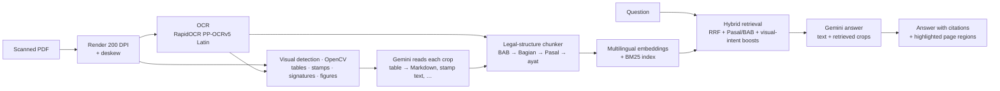
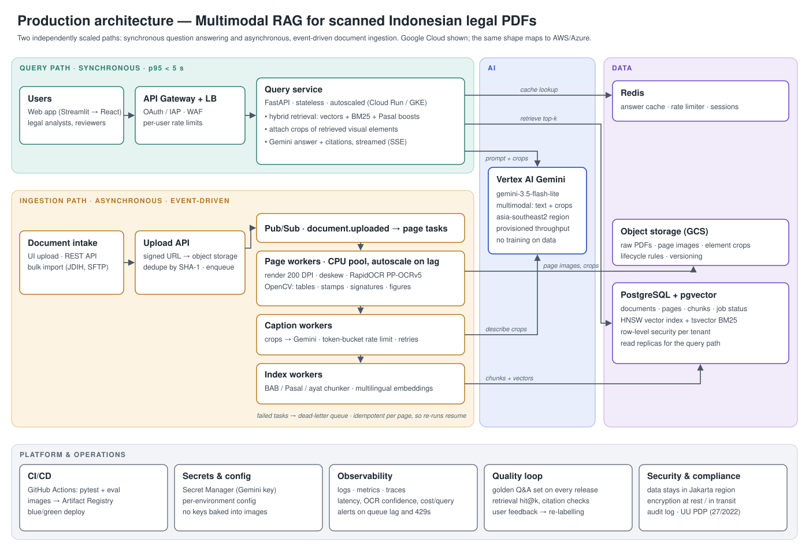

# Multimodal RAG for scanned Indonesian legal PDFs

A retrieval-augmented generation (RAG) pipeline that reads **scanned** Indonesian legal documents
(UU, PP, Perpres, Permen, Perda, Putusan…), understands both their **text** and their **visual
elements** — tables, stamps (*cap/stempel*), signatures, emblems/logos — and answers questions with
page-level citations in a web UI.

- **Local, CPU-only:** rendering, deskewing, OCR, visual-element detection, chunking, embeddings
  and hybrid retrieval.
- **Google Gemini** (`gemini-3.5-flash-lite`): reads the cropped visual elements during ingestion
  and writes the final answer, receiving the crops of retrieved stamps/tables/signatures with the
  question. Without a Gemini key the pipeline still runs end to end, with heuristic element
  descriptions and extractive answers.

## How it works



| Stage | Module | What it does |
|---|---|---|
| Render & OCR | `legal_rag/ocr.py` | PyMuPDF render at 200 DPI; projection-profile deskew (±5°); RapidOCR PP-OCRv5 **Latin** model (keeps Indonesian word spacing); same-row segments merged into reading order. Pages with a real text layer skip OCR. |
| Visual elements | `legal_rag/vision.py` | **Tables:** morphological line detection → cell grid → OCR text per cell → Markdown. **Stamps:** coloured-ink mask + Hough circle; curved ring text read by polar unwrapping. **Signatures:** sparse ink not explained by OCR, tied to nearby name/position text. **Figures:** dense non-text ink (Garuda emblem, logos). |
| Gemini | `legal_rag/llm.py` | OpenAI-compatible Gemini endpoint; crops described in Indonesian at ingest; streaming answers; retries with backoff on 429/503. |
| Structure | `legal_rag/structure.py` | Detects document type/number/year/subject; tracks Menimbang, Mengingat, Menetapkan, BAB, Bagian, Paragraf, Pasal, Penutup, Penjelasan, Lampiran; one chunk per Pasal (split at ayat if long), each carrying its full hierarchy; every visual element becomes its own chunk. |
| Index & retrieval | `legal_rag/index.py` | fastembed multilingual MiniLM (ONNX) + BM25, fused with reciprocal-rank fusion; exact boosts for "Pasal 3"/"BAB II"; boosts for stamp/signature/table/figure questions. |
| Answering | `legal_rag/rag.py` | Prompt with numbered sources; crops of retrieved visual elements attached; extractive fallback. |
| UI | `app.py` | Streamlit: upload & process PDFs, chat with cited sources (crop + highlighted page), per-page inspector of OCR and detected elements. |

## Setup

Requires Python 3.10+ (tested on 3.11, Windows, CPU only).

```bash
git clone <this-repo> && cd rag
python -m venv .venv
.venv\Scripts\activate            # Linux/macOS: source .venv/bin/activate
pip install -r requirements.txt
```

The OCR and embedding models (~250 MB) download automatically on first use.

**Gemini key:** create one at <https://aistudio.google.com/apikey>, then

```bash
copy .env.example .env            # Linux/macOS: cp .env.example .env
```

and set `GEMINI_API_KEY=...` in `.env` (git-ignored). Page text and cropped elements are sent to
Google, so don't use a free-tier key for confidential documents. The free tier is rate-limited:
the client retries automatically, but ingesting documents with many visual elements is slower.

## Run

```bash
streamlit run app.py
```

- **Sidebar:** upload PDFs → *Proses dokumen*. Progress is shown per page; finished pages are
  cached, so an interrupted run resumes. Lists documents with detected type/number/year.
- **💬 Tanya jawab:** ask in Indonesian or English. Each source shows the chunk text, the cropped
  visual element and the page image with the region highlighted.
- **🔎 Jelajahi dokumen:** per-page view with colour-coded boxes (text, table, stamp, signature,
  figure), extracted tables, Gemini descriptions and raw OCR text.

Command line:

```bash
python -m legal_rag.cli ingest "pdfs/*.pdf"
python -m legal_rag.cli ask "Berapa tarif retribusi untuk hotel?"
python -m legal_rag.cli ask "Apa isi Pasal 4?" --sources-only
python -m legal_rag.cli list
```

## Test

```bash
pip install -r requirements-dev.txt
pytest -v
```

| Test file | Covers | Needs |
|---|---|---|
| `tests/test_units.py` | tokenizer, Roman numerals, OCR row merging, table grid → Markdown, stamp-ring de-duplication, Gemini request/error format | nothing |
| `tests/test_structure.py` | metadata extraction, BAB/Pasal chunking, OCR "Pasal l" → "Pasal 1", ayat splitting, visual-element chunks | nothing |
| `tests/test_pipeline.py` | **end to end**: generates a scanned sample, runs OCR + vision + indexing, checks metadata, the four element types, the extracted table and 9 retrieval questions; extractive fallback | ~30 s CPU |
| `tests/test_pipeline.py::test_gemini_answer_live` | real Gemini answer on the sample | `GEMINI_API_KEY` (skipped otherwise) |

### Try it by hand with the synthetic sample

```bash
python scripts/make_sample_pdf.py data/samples/contoh_perda.pdf
python -m legal_rag.cli ingest data/samples/contoh_perda.pdf
python scripts/eval_retrieval.py                 # expected: 9/9 top-1 correct
python -m legal_rag.cli ask "Siapa yang menandatangani dan apa tulisan pada stempelnya?"
```

The sample is a 2-page image-only *Peraturan Daerah* with skew, scan noise, a logo, a ruled tariff
table, a blue round stamp with curved text and a signature.

## Configuration

Set in `.env` or as environment variables.

| Variable | Default | Purpose |
|---|---|---|
| `GEMINI_API_KEY` | — | Gemini key; without it answers are extractive |
| `GEMINI_MODEL` | `gemini-3.5-flash-lite` | used for crops and answers |
| `GEMINI_REASONING_EFFORT` | `low` | `low` is fast; empty uses the model default |
| `LEGALRAG_CAPTION_WITH_VLM` | `1` | describe visual elements with Gemini at ingest |
| `LEGALRAG_ANSWER_WITH_IMAGES` | `1` | attach retrieved crops to the question |
| `LEGALRAG_DATA_DIR` | `data/store` | processed documents |
| `LEGALRAG_DPI` | `200` | render resolution (300 for very small print) |
| `LEGALRAG_EMBED_MODEL` | `sentence-transformers/paraphrase-multilingual-MiniLM-L12-v2` | `intfloat/multilingual-e5-large` gives better recall (2.2 GB, slower); requires re-ingesting |
| `LEGALRAG_TOP_K` | `6` | sources per answer |

## Project layout

```
app.py                  Streamlit web UI
legal_rag/
  config.py             settings (.env + environment variables)
  ocr.py                rendering, deskew, OCR, reading order
  vision.py             tables / stamps / signatures / figures, polar stamp reading
  llm.py                Gemini client: chat, streaming, retries, element captions
  structure.py          Indonesian legal metadata + BAB/Pasal/ayat chunking
  ingest.py             ingestion pipeline and on-disk store
  index.py              hybrid retrieval (dense + BM25 + structural boosts)
  rag.py                prompt building, multimodal answering, extractive fallback
  cli.py                command line
scripts/
  make_sample_pdf.py    synthetic scanned Perda for testing
  eval_retrieval.py     retrieval check (9 questions)
tests/                  pytest suite
docs/
  ARCHITECTURE.md       production scaling and deployment
  architecture.svg      production architecture diagram
  presentation.pptx     slides explaining the code and process
```

## Production architecture

How this would be scaled and deployed (event-driven ingestion workers, stateless query service,
Postgres + pgvector, Vertex AI Gemini in the Jakarta region, CI/CD and evaluation gates) is
described in [docs/ARCHITECTURE.md](docs/ARCHITECTURE.md).



## Limits

- CPU speed: about 5–10 s per page for OCR and detection, plus 2–7 s per visual element for Gemini.
- Table extraction targets **ruled** tables (the norm in regulations and their *lampiran*);
  borderless tables fall back to row text, or to Gemini's transcription.
- Detection is heuristic (OpenCV), tuned on typical Indonesian scans. Check the
  *Jelajahi dokumen* tab on your own documents and adjust thresholds in `vision.py` if needed.
- Pages scanned sideways or upside down (90°/180°) are not auto-rotated; only small skew is corrected.
- Answers are research aids, not legal advice.
