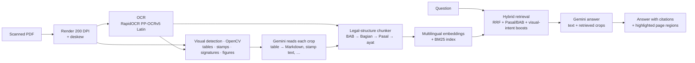

# Multimodal RAG for scanned Indonesian legal PDFs

A retrieval-augmented generation (RAG) pipeline that reads **scanned** Indonesian legal documents
(UU, PP, Perpres, Permen, Perda, Putusan…), understands both their **text** and their **visual
elements** — tables, stamps (*cap/stempel*), signatures, emblems/logos — and answers questions with
page-level citations in a web UI.

- **Local, CPU-only:** rendering, deskewing, OCR, visual-element detection, chunking, embeddings
  and hybrid retrieval.
- **Google Gemini** (`gemini-3.5-flash-lite`): reads the cropped visual elements during ingestion
  and writes the final answer, receiving the crops of retrieved stamps/tables/signatures with the
  question. Without a Gemini key the pipeline still runs end to end, with heuristic element
  descriptions and extractive answers.

## How it works



| Stage | Module | What it does |
|---|---|---|
| Render & OCR | `legal_rag/ocr.py` | PyMuPDF render at 200 DPI; projection-profile deskew (±5°); RapidOCR PP-OCRv5 **Latin** model (keeps Indonesian word spacing); same-row segments merged into reading order. Pages with a real text layer skip OCR. |
| Visual elements | `legal_rag/vision.py` | **Tables:** morphological line detection → cell grid → OCR text per cell → Markdown. **Stamps:** coloured-ink mask + Hough circle; curved ring text read by polar unwrapping. **Signatures:** sparse ink not explained by OCR, tied to nearby name/position text. **Figures:** dense non-text ink (Garuda emblem, logos). |
| Gemini | `legal_rag/llm.py` | OpenAI-compatible Gemini endpoint; crops described in Indonesian at ingest; streaming answers; retries with backoff on 429/503. |
| Structure | `legal_rag/structure.py` | Detects document type/number/year/subject; tracks Menimbang, Mengingat, Menetapkan, BAB, Bagian, Paragraf, Pasal, Penutup, Penjelasan, Lampiran; one chunk per Pasal (split at ayat if long), each carrying its full hierarchy; every visual element becomes its own chunk. |
| Index & retrieval | `legal_rag/index.py` | fastembed multilingual MiniLM (ONNX) + BM25, fused with reciprocal-rank fusion; exact boosts for "Pasal 3"/"BAB II"; boosts for stamp/signature/table/figure questions. |
| Answering | `legal_rag/rag.py` | Prompt with numbered sources; crops of retrieved visual elements attached; extractive fallback. |
| UI | `app.py` | Streamlit: upload & process PDFs, chat with cited sources (crop + highlighted page), per-page inspector of OCR and detected elements. |
| Evaluation | `legal_rag/evaluate.py` | Runs a ground-truth CSV through retrieval and answering; reports hit@k, MRR, keyword recall, citation correctness and a Gemini-judge score. |

## Setup

Requires Python 3.10+ (tested on 3.11, Windows, CPU only).

```bash
git clone <this-repo> && cd rag
python -m venv .venv
.venv\Scripts\activate            # Linux/macOS: source .venv/bin/activate
pip install -r requirements.txt
```

The OCR and embedding models (~250 MB) download automatically on first use.

**Gemini key:** create one at <https://aistudio.google.com/apikey>, then

```bash
copy .env.example .env            # Linux/macOS: cp .env.example .env
```

and set `GEMINI_API_KEY=...` in `.env` (git-ignored). Page text and cropped elements are sent to
Google, so don't use a free-tier key for confidential documents. The free tier is rate-limited:
the client retries automatically, but ingesting documents with many visual elements is slower.

## Run

```bash
streamlit run app.py
```

- **Sidebar:** upload PDFs → *Proses dokumen*. Progress is shown per page; finished pages are
  cached, so an interrupted run resumes. Lists documents with detected type/number/year.
- **💬 Tanya jawab:** ask in Indonesian or English. Each source shows the chunk text, the cropped
  visual element and the page image with the region highlighted.
- **🔎 Jelajahi dokumen:** per-page view with colour-coded boxes (text, table, stamp, signature,
  figure), extracted tables, Gemini descriptions and raw OCR text.

Command line:

```bash
python -m legal_rag.cli ingest "pdfs/*.pdf"
python -m legal_rag.cli ask "Berapa tarif retribusi untuk hotel?"
python -m legal_rag.cli ask "Apa isi Pasal 4?" --sources-only
python -m legal_rag.cli list
```

## Test (evaluation against ground truth)

The pipeline is evaluated on a real regulation, **Peraturan Presiden Nomor 76 Tahun 2013 tentang
Pengelolaan Pengaduan Pelayanan Publik** (14 pages), with a ground-truth file of 52 questions:
[`eval/ground_truth_perpres_76_2013.csv`](eval/ground_truth_perpres_76_2013.csv).

| Column | Content |
|---|---|
| `id` | question id, e.g. `GT001` |
| `question` | the question |
| `answer` | the correct answer according to the document |
| `source` | where the answer is, e.g. `Pasal 7 ayat (1)-(3), halaman 6` or `Bagian Mengingat, halaman 1` |
| `category` | question type, e.g. `definisi`, `mekanisme`, `batas_waktu` |

### Steps

1. **Ingest the PDF.** The document id is the first 12 characters of the file's SHA-1, so the
   same PDF always gets the same id (`322882ba82ce` for this file):

   ```bash
   python -m legal_rag.cli ingest "path/to/Perpres 76 2013.pdf"
   python -m legal_rag.cli list
   ```

2. **Retrieval only** (fast, no Gemini calls, no quota used):

   ```bash
   python -m legal_rag.cli eval eval/ground_truth_perpres_76_2013.csv --doc 322882ba82ce --retrieval-only --out eval/results/perpres_76_2013_retrieval
   ```

3. **Full evaluation**: retrieval + Gemini answers + Gemini as judge (needs `GEMINI_API_KEY`; about
   104 Gemini calls, several minutes on the free tier because of rate limits):

   ```bash
   python -m legal_rag.cli eval eval/ground_truth_perpres_76_2013.csv --doc 322882ba82ce --judge --out eval/results/perpres_76_2013
   ```

   Options: `-k` (sources per question, default 6), `--limit N` (first N questions only, useful
   for a quick check), `--out` (output prefix).

4. **Read the results**: `eval/results/perpres_76_2013.md` has the summary and a per-question
   table; `eval/results/perpres_76_2013.csv` has every question with the system's full answer and
   the judge's reason.

### What is measured

| Level | Metric | How |
|---|---|---|
| Retrieval | hit@1, hit@3, hit@6, MRR | `source` is parsed into the expected Pasal (or section such as Mengingat). A result counts if its chunk comes from that Pasal. MRR = mean of 1 / rank of the first correct result. |
| Retrieval | page (exact / ±1) | whether the expected page is among the top results; informational, because the ground truth's page numbers are mostly one lower than the PDF page index |
| Answer | keyword recall | share of the reference answer's key words (stop words removed) found in the system's answer |
| Answer | correct citation | the answer cites `[n]` and a cited source is from the expected Pasal/section |
| Answer | Gemini judge (0–2) | Gemini compares the system's answer with the reference: 2 correct, 1 partial, 0 wrong |

### Results

Run of 2026-11-19 on `322882ba82ce` (52 questions, top-k 6, `gemini-3.5-flash-lite`):

| Metric | Value |
|---|---|
| Retrieval hit@1 / hit@3 / hit@6 | 63% / 79% / 87% |
| MRR | 0.72 |
| Expected page in top-6 (exact / ±1 page) | 75% / 96% |
| Answer keyword recall | 84% |
| Answers with a `[n]` citation | 98% |
| Citation points to the expected Pasal/section | 87% |
| Gemini judge: correct / partial / wrong | 43 / 2 / 5 (50 judged; 2 judge calls timed out) |
| Answer time, median / slowest | 9.7 s / 237 s (Gemini was returning 503 "overloaded") |

What the run shows:

- **Retrieval is the bottleneck.** 6 of the 7 wrong or partial answers are questions whose
  source never reached the top 6, so Gemini never saw it. When the source is retrieved, the answer
  is almost always correct.
- **This PDF ships its own (old) OCR text layer**, which the pipeline uses instead of running OCR.
  That layer has misreadings ("PRESIOEN", "BABI"), many one-word lines and lines out of reading
  order (page 1 starts with "tclah ... 2. Undang-Undang" and ends with "Mengingat / Menimbang").
  Text-layer lines are not re-ordered (`merge_rows` only runs on OCR'd pages), so the Mengingat
  section is scattered and GT001 is not found.
- **Section labels go wrong**: the word "memperhatikan" at the start of a line inside Pasal 8 is
  taken as the *Memperhatikan* heading, so Pasal 8–19 carry that label (Pasal numbers stay correct).
- **Metadata is wrong** for this file (type empty, number/year read as 125/2004), so the document
  title in every chunk is just the file name.
- **Ground-truth page numbers** are mostly one lower than the PDF page index, which is why the page
  check is reported both exact and ±1 and is not used for pass/fail.
- One answer (GT001) was cut off mid-sentence; re-running it gave a complete answer, so the stream
  most likely dropped while Gemini was overloaded.

The evaluation code is in [`legal_rag/evaluate.py`](legal_rag/evaluate.py); the `eval` command is
in `legal_rag/cli.py`. To evaluate another document, write a CSV with the same five columns, ingest
the PDF, and pass its id with `--doc`.

## Configuration

Set in `.env` or as environment variables.

| Variable | Default | Purpose |
|---|---|---|
| `GEMINI_API_KEY` | — | Gemini key; without it answers are extractive |
| `GEMINI_MODEL` | `gemini-3.5-flash-lite` | used for crops and answers |
| `GEMINI_REASONING_EFFORT` | `low` | `low` is fast; empty uses the model default |
| `LEGALRAG_CAPTION_WITH_VLM` | `1` | describe visual elements with Gemini at ingest |
| `LEGALRAG_ANSWER_WITH_IMAGES` | `1` | attach retrieved crops to the question |
| `LEGALRAG_DATA_DIR` | `data/store` | processed documents |
| `LEGALRAG_DPI` | `200` | render resolution (300 for very small print) |
| `LEGALRAG_EMBED_MODEL` | `sentence-transformers/paraphrase-multilingual-MiniLM-L12-v2` | `intfloat/multilingual-e5-large` gives better recall (2.2 GB, slower); requires re-ingesting |
| `LEGALRAG_TOP_K` | `6` | sources per answer |

## Project layout

```
app.py                  Streamlit web UI
legal_rag/
  config.py             settings (.env + environment variables)
  ocr.py                rendering, deskew, OCR, reading order
  vision.py             tables / stamps / signatures / figures, polar stamp reading
  llm.py                Gemini client: chat, streaming, retries, element captions
  structure.py          Indonesian legal metadata + BAB/Pasal/ayat chunking
  ingest.py             ingestion pipeline and on-disk store
  index.py              hybrid retrieval (dense + BM25 + structural boosts)
  rag.py                prompt building, multimodal answering, extractive fallback
  evaluate.py           evaluation against a ground-truth CSV
  cli.py                command line: ingest, ask, list, eval
eval/
  ground_truth_perpres_76_2013.csv   52 questions with answers and sources
  results/              evaluation outputs (.csv per question, .md summary)
docs/
  ARCHITECTURE.md       production scaling and deployment
  architecture.svg      production architecture diagram
  presentation.pptx     slides explaining the code and process
```

## Production architecture

Full design: [docs/ARCHITECTURE.md](docs/ARCHITECTURE.md).


Two paths that scale independently:

- **Ingestion (asynchronous):** Upload API (with official JDIH metadata) → Pub/Sub, one task per
  page → **page workers** (text-layer quality gate, deskew, OCR, OpenCV elements) → **caption
  workers** (Gemini, shared rate limiter) → **index workers** (BAB/Pasal chunking, embeddings) →
  PostgreSQL + pgvector and object storage. About 20,000 pages/hour with 50 workers.
- **Query (synchronous, p95 < 5 s to first token):** API gateway (OAuth, rate limits) → stateless
  FastAPI **query service**: hybrid retrieval → top-20 → **re-ranker** → top-6 → Vertex AI Gemini in
  the Jakarta region, streamed with citations; incomplete streams are retried.
- **Operations:** an evaluation gate in CI (`cli eval --retrieval-only` on every pull request, the
  full judged run nightly, judge model ≠ answering model), Secret Manager, tracing and cost
  metrics, data kept in the Jakarta region.

### What the first evaluation changed

The Perpres 76/2013 evaluation (see [Test](#test-evaluation-against-ground-truth)) added these to
the design:

| Finding | Architecture change |
|---|---|
| 6 of 7 wrong answers had their source outside the top 6 (hit@1 63%, hit@6 87%) | wider candidate pool (top-20) and a re-ranking stage |
| the PDF's own old OCR layer was scrambled and full of misreadings | text-layer quality gate per page: reuse, re-order, or re-OCR |
| title-block metadata was misread (number/year 125/2004) | official metadata from the JDIH import, parsing only as fallback |
| one answer was cut off while Gemini returned 503 | retry streams that end without a finish marker; fallback model; provisioned throughput |
| the same model answered and judged | a different, stronger judge model plus periodic human review |

## Limits

- CPU speed: about 5–10 s per page for OCR and detection, plus 2–7 s per visual element for Gemini.
- Table extraction targets **ruled** tables (the norm in regulations and their *lampiran*);
  a table is detected when its ruling lines join into a frame or grid. Tables with only
  horizontal rules, or no rules at all, are not recognised as tables: their text is indexed row by row.
- Detection is heuristic (OpenCV), tuned on typical Indonesian scans. Check the
  *Jelajahi dokumen* tab on your own documents and adjust thresholds in `vision.py` if needed.
- Pages scanned sideways or upside down (90°/180°) are not auto-rotated; only small skew is corrected.
- Answers are research aids, not legal advice.
