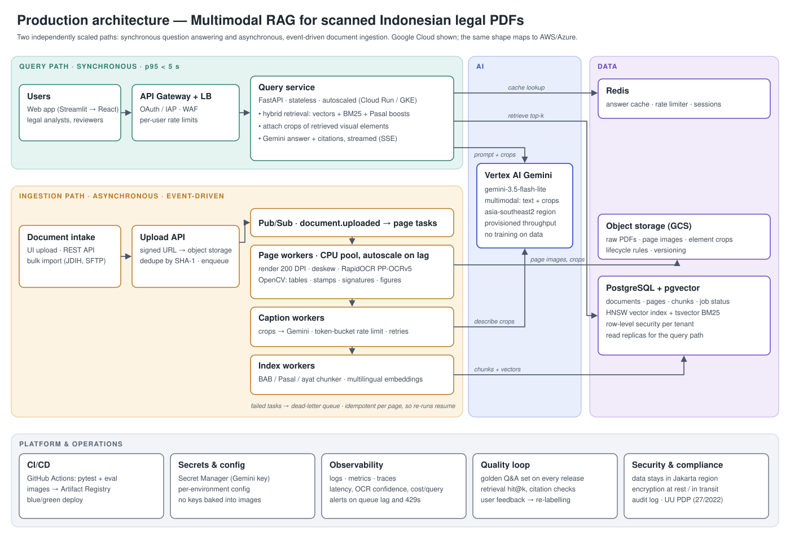

# Production architecture

How this prototype would be scaled and deployed for real use: thousands of scanned
regulations and court documents, many concurrent analysts, auditable answers.

## Prototype → production mapping

| Prototype (this repo) | Production | Why |
|---|---|---|
| Streamlit app | React web app + **FastAPI query service** behind an API gateway | stateless, horizontally scalable, auth + rate limits at the edge |
| `ingest_pdf()` loop, one process | **Upload API → Pub/Sub → page workers → caption workers → index workers** | pages are processed in parallel; slow OCR never blocks queries |
| `data/store/<doc_id>/*.jpg, *.png` | **Object storage (GCS)** | durable, cheap, lifecycle rules |
| `pages.json`, `chunks.json`, `embeddings.npy` | **PostgreSQL + pgvector** (HNSW) with `tsvector` for BM25 | one transactional store for metadata, vectors and keyword search; row-level security per tenant |
| In-memory BM25 + numpy cosine, top-6 | pgvector ANN + Postgres full-text → top-20 → **re-ranker** → top-6 | scales past RAM; re-ranking targets the measured weak spot (right source found, wrong rank) |
| Metadata parsed from the title block | **Official metadata from the JDIH import**; title-block parsing (or one Gemini call on page 1) only as fallback | parsing failed on the real Perpres (number/year read as 125/2004) |
| Embedded text layer used whenever it exists | **Text-layer quality gate**: reuse, re-order, or re-OCR per page | the real Perpres shipped an old OCR layer with scrambled line order |
| Gemini API key in `.env` | **Vertex AI Gemini** in `asia-southeast2` (Jakarta), identity in Secret Manager | data residency, SLAs, provisioned throughput, no training on customer data |
| `python -m legal_rag.cli eval` + `eval/ground_truth_*.csv` | **CI evaluation gate** on every change, full judged run nightly, one golden set per document type | catches retrieval/answer regressions before deploy |

## What the first evaluation changed

The prototype was evaluated on *Peraturan Presiden Nomor 76 Tahun 2013* with 52 ground-truth
questions (`eval/ground_truth_perpres_76_2013.csv`). Each architecture change below answers a
measured problem:

| Finding | Evidence | Change |
|---|---|---|
| Retrieval is the bottleneck, not the model | Gemini judge 43 correct / 2 partial / 5 wrong; 6 of the 7 wrong/partial answers had their source outside the top 6; hit@1 63% vs hit@6 87% | larger candidate pool (top-20) and a **re-ranking stage** before the prompt; evaluation gate on retrieval metrics |
| Embedded OCR text layers can be worse than fresh OCR | the Perpres text layer had misreadings ("PRESIOEN", "BABI"), one-word lines and scrambled order; the Mengingat section was never retrieved | **text-layer quality gate** in the page workers |
| Title-block metadata parsing is fragile | type empty, number/year read as 125/2004, so the document title in every chunk was just the file name | take **metadata from the JDIH record** at import |
| Structure markers fire inside Pasal text | "memperhatikan" at the start of a line in Pasal 8 relabelled Pasal 8–19 | section markers only valid inside the opening (pembukaan) — a code fix, checked by the eval gate |
| Gemini streams can end early under load | one answer cut mid-sentence while Gemini returned 503; a re-run was complete | treat a stream without a finish marker as a failure and **retry**; fallback model; provisioned throughput |
| Judging with the answering model is biased | answer and judge were both `gemini-3.5-flash-lite` | use a **different, stronger judge model** in the evaluation workers, plus periodic human review |

## Ingestion path (asynchronous)

1. **Upload API** issues a signed URL; the PDF lands in object storage. The SHA-1 of the file is the
   document id, so re-uploads are deduplicated. Bulk imports from JDIH carry the **official
   metadata** (type, number, year, subject), which is stored instead of being parsed from the page.
2. A `document.uploaded` event fans out into **one task per page**.
3. **Page workers** (CPU pool, autoscaled on queue lag) render the page and run the **text-layer
   quality gate**: an embedded text layer is used only if it looks like clean text (share of
   dictionary words, words per line, plausible reading order); its lines are always re-ordered by
   position; otherwise the page is deskewed and OCR'd. Then the OpenCV detectors run. Each page
   result is written idempotently, so a crashed or retried job resumes where it stopped. Failures
   go to a dead-letter queue for inspection.
4. **Caption workers** send element crops to Gemini behind a token-bucket limiter shared by all
   workers (Redis), with exponential backoff on 429/503.
5. **Index workers** run once all pages are done: legal-structure chunking (BAB → Pasal → ayat),
   embeddings, and a single transactional write to Postgres. The document then becomes searchable.

Throughput scales linearly with page workers: at ~8 s/page on one vCPU, 50 workers ingest
roughly 20,000 pages per hour.

## Query path (synchronous)

1. Gateway authenticates (OAuth/IAP) and rate-limits per user.
2. The **query service** checks the Redis answer cache, then runs hybrid retrieval in Postgres
   (vector ANN + full-text), fuses with RRF, applies the Pasal/BAB and visual-intent boosts, and
   takes the **top 20**.
3. A **re-ranker** (a multilingual cross-encoder, or Gemini scoring the 20 candidates) orders them
   and keeps the top 6.
4. Crops of retrieved stamps, tables, signatures and figures are fetched from object storage and
   sent with the question to Gemini; the answer streams back to the browser with citations that
   link to the highlighted region of the page image. A stream that ends **without a finish marker**
   is treated as a failure and retried once, then served from a fallback model.

Target: p95 under 5 s to first token. The service is stateless, so it autoscales on request
concurrency.

## Evaluation and quality loop

- **Golden sets** live next to the code (`eval/ground_truth_*.csv`, columns
  `id, question, answer, source, category`), one per document type (UU, PP, Perpres, Perda, Putusan),
  written and checked by legal staff.
- **On every pull request** CI runs `cli eval --retrieval-only` (no model calls, about a minute)
  and blocks the merge if hit@6 or MRR drops below the last release.
- **Nightly** an evaluation worker runs the full `cli eval --judge` against Vertex AI, with the
  judge on a different, stronger model than the one answering; results are stored per version so
  trends are visible.
- **Every month** a sample of judged answers is reviewed by a person, to check the judge itself.
- Questions that fail in real use are added to the golden set.

## Operations

- **CI/CD:** GitHub Actions runs the evaluation gate, builds container images, pushes to Artifact
  Registry, and deploys blue/green.
- **Observability:** structured logs, traces per question (retrieval → re-rank → prompt → model),
  metrics for latency, OCR confidence, text-layer gate decisions, Gemini tokens and cost per query,
  503/429 rates and incomplete streams; alerts on queue lag and error rates.
- **Security & compliance:** documents stay in the Jakarta region, encryption at rest and in
  transit, per-tenant isolation, audit log of who asked what, aligned with UU 27/2022 (PDP).
